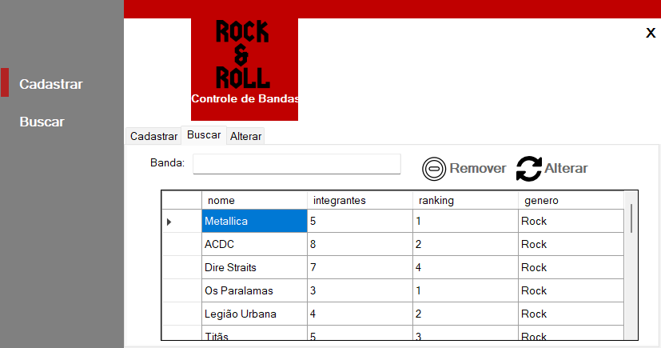
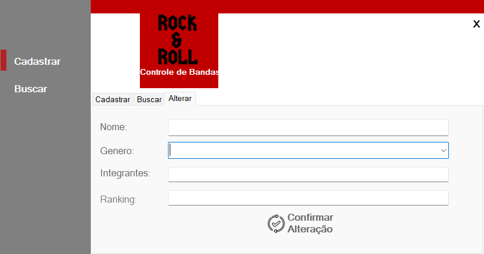

# Sistema de Cadastro de Bandas

Sistema desktop desenvolvido em C# Windows Forms para gerenciamento e cadastro de bandas musicais.

## 📋 Descrição

Este projeto é um sistema de cadastro que permite gerenciar informações sobre bandas musicais, incluindo nome, número de integrantes, ranking e gênero musical. O sistema utiliza MySQL como banco de dados e oferece uma interface gráfica intuitiva para cadastro e busca de informações.

## 🚀 Tecnologias Utilizadas

- **C# (.NET Framework)** - Linguagem de programação
- **Windows Forms** - Framework para interface gráfica
- **MySQL 8.1.0** - Sistema de gerenciamento de banco de dados
- **ADO.NET** - Acesso a dados
- **Visual Studio** - IDE de desenvolvimento

## 📦 Dependências

O projeto utiliza as seguintes bibliotecas NuGet:

- MySql.Data 8.1.0
- DotNetEnv 3.2.0

## Telas da aplicação
### LOGIN

### CADASTRO DE BANDAS

### CONSULTA E BUSCA

### ATUALIZAR BANDA

### ADICIONAR NOVO GÊNERO


## 🗄️ Estrutura do Banco de Dados

O sistema utiliza duas tabelas principais:

### Tabela `generos`
- `idgenero` (INT, AUTO_INCREMENT, PRIMARY KEY)
- `genero` (VARCHAR(45))

Gêneros pré-cadastrados: Rock, Metal, Pagode, Gospel, Funk

### Tabela `bandas`
- `idbandas` (INT, AUTO_INCREMENT, PRIMARY KEY)
- `nome` (VARCHAR(45))
- `integrantes` (INT)
- `ranking` (INT)
- `fk_genero` (INT, FOREIGN KEY)

### Tabela `usuarios`
- `idusuarios` (INT, AUTO_INCREMENT, PRIMARY KEY)
- `nome` (VARCHAR(100))
- `senha` (VARCHAR(100))

### Stored Procedures
- `consultaLogin` - Consulta usuários
- `sp_insereBanda` - Insere uma nova banda no banco
- `sp_listaBandas` - Lista todas as bandas com seus gêneros
- `sp_listaGeneros` - Lista todos os gêneros disponíveis
- `sp_alteraBanda` - Atualiza dados de uma banda
- `sp_insereGenero` - Insere novo gênero de banda
- `sp_removeBanda` - Remove o registro de uma banda

## ⚙️ Instalação e Configuração

### Pré-requisitos

- Visual Studio 2019 ou superior
- MySQL Server 8.0 ou superior
- .NET Framework 4.7.2 ou superior


## Passo a passo

### 1. Clone o repositório

```bash
git clone <url-do-repositorio>
```

### 2. Configure o banco de dados

Copie o arquivo `.env.example`, renomeie-o para `.env` e preencha as variáveis com os dados de conexão do banco de dados.

### 3. Restaure os pacotes NuGet

No Visual Studio:

1. Clique com o botão direito sobre a solução.
2. Selecione **Restore NuGet Packages**.
3. Aguarde a conclusão da restauração dos pacotes.

### 4. Compile e execute o projeto

No Visual Studio:

1. Pressione `F5`; ou
2. Clique em **Start** para compilar e executar a aplicação.


## 🎯 Funcionalidades

- ✅ **Cadastro de Bandas** - Adicione novas bandas com informações completas
- 🔍 **Busca de Bandas** - Pesquise bandas cadastradas
- 📝 **Alteração de Dados** - Edite informações de bandas existentes
- 🗑️ **Remoção de Bandas** - Exclua registros do sistema
- 🎵 **Gerenciamento de Gêneros** - Adicione novos gêneros musicais
- 📊 **Visualização em Lista** - Veja todas as bandas cadastradas

## 🎨 Interface

O sistema possui uma interface com navegação por abas:

- **Aba Cadastro** - Formulário para inserir novas bandas
- **Aba Busca** - Interface para pesquisar e visualizar bandas cadastradas
- **Aba Alterar** - Interface para atualizar registros de bandas cadastradas
- **Aba Cadastro de Gênero** - Interface para adicionar novos gêneros

A navegação é facilitada por botões laterais com indicador visual de aba selecionada.


## 📝 Licença

Este projeto é um trabalho acadêmico desenvolvido para fins educacionais.

## 👥 Autor

Desenvolvido como projeto da disciplina de Linguagens e Técnicas Avançadas de Programação

---

**Nota**: Este é um projeto modelo para fins educacionais. Certifique-se de implementar as validações e tratamento de erros adequados antes de usar em produção.
